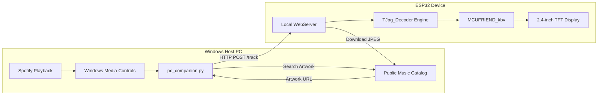
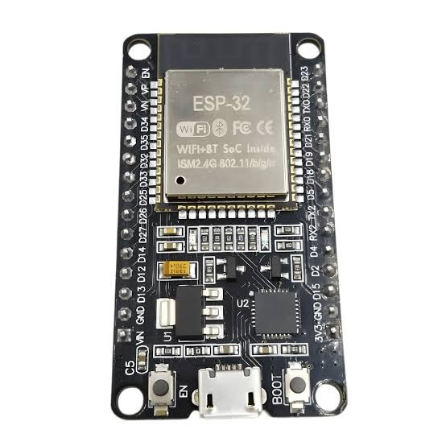
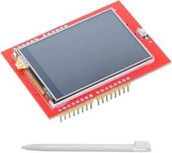
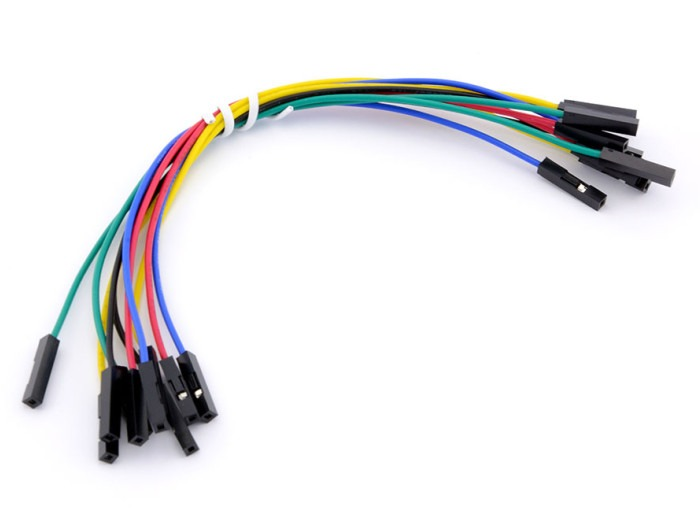

<div align="center">

# 🎵 ESP32 Spotify Album Art & Track Display

**Real-time desktop music companion displaying high-resolution album posters, track metadata, and dynamic progress bars on a 2.4" TFT display.**

[](https://www.espressif.com/)
[-red.svg)](#hardware-requirements)
[](https://www.arduino.cc/)
[](https://www.python.org/)
[](LICENSE)

</div>

---

## 📌 Overview

This project turns an **ESP32** and a **2.4" TFT LCD Shield** into a standalone desktop smart album poster display for your music:
- 🖼️ **Dynamic High-Res Album Art:** Streams and decodes JPEG cover art directly in ESP32 RAM using `TJpg_Decoder`.
- 🎶 **Live Track Information:** Displays track title, artist name, and album name with smart text wrapping.
- ⏱️ **Real-time Progress Bar:** Smooth elapsed and total time tracking (`mm:ss / mm:ss`).
- 🟢 **Supports BOTH Spotify Free & Premium:**
  - **Spotify Free Mode:** Driven via a zero-latency PC Companion hooking into Windows System Media Transport Controls (supports Google Chrome, Edge, Brave, and Spotify Desktop).
  - **Spotify Cloud Mode:** Standalone Direct Wi-Fi polling via Spotify Web API OAuth 2.0 (for Premium accounts).
- 🔍 **Zero-Config Network Auto-Discovery:** Companion automatically scans the local subnet to locate the ESP32 even when your router changes its IP address.

---

## 🏗️ Architecture



---

## 🧰 Hardware Requirements

| Image | Component | Description | Specification / Role |
| :---: | :--- | :--- | :--- |
|  | **Microcontroller** | ESP32 Development Board (ESP-WROOM-32 / WeMos D1 R32) | Dual-core 240MHz, 2.4 GHz Wi-Fi, drives display & runs local HTTP server |
|  | **Display Module** | 2.4" TFT LCD Shield (ILI9341 / 0xD3D3) | 320x240 RGB resolution, 8-bit parallel bus, onboard display driver |
|  | **Wiring** | Jumper Wires (Dupont Cables) | Connects ESP32 GPIO pins to TFT shield data (D0-D7) & control lines |
| <span style="font-size: 2rem;">📶</span> | **Connectivity** | 2.4 GHz Wi-Fi (802.11 b/g/n) | Network communication for track payloads and album art streams |

---

## 📂 Project Structure

```text
esp-spotify-display/
├── assets/                       # Hardware previews & documentation images
├── Spotify_TFT_Display/
│   ├── Spotify_TFT_Display.ino   # Main ESP32 firmware (Wi-Fi, HTTP Server, JPEG Decoder, TFT UI)
│   └── config.example.h          # Template for Wi-Fi credentials
├── pc_companion.py               # Windows host companion with auto-discovery & WinRT integration
├── get_token.py                  # One-click Spotify OAuth 2.0 Refresh Token generator
├── config.example.h              # Root configuration template
├── .env.example                  # Environment variables template
├── .gitignore                    # Ensures secrets & binaries are never committed
├── LICENSE                       # MIT License
└── README.md                     # Documentation
```

---

## 🚀 Quick Start Guide

### 1. Hardware & Arduino Setup
1. Open **Arduino IDE**.
2. Go to **Tools** -> **Manage Libraries...** and install:
   - **`MCUFRIEND_kbv`** (by David Prentice)
   - **`Adafruit GFX Library`** (by Adafruit)
   - **`TJpg_Decoder`** (by Bodmer)
   - **`ArduinoJson`** (by Benoît Blanchon)
3. Duplicate `Spotify_TFT_Display/config.example.h` and rename it to `Spotify_TFT_Display/config.h`:
   ```cpp
   const char* WIFI_SSID     = "YOUR_2.4GHZ_WIFI";
   const char* WIFI_PASSWORD = "YOUR_WIFI_PASSWORD";
   ```
4. Open `Spotify_TFT_Display/Spotify_TFT_Display.ino` in Arduino IDE.
5. Select your ESP32 board and COM port, then click **Upload (`Ctrl + U`)**.
6. The display will show its assigned IP address and status:
   ```text
   🟢 Spotify Ready!
   ESP32 IP Address: 192.168.10.XX
   ```

---

### 2. Run the PC Companion (Supports Spotify Free & Web Player)
The companion reads what you are playing directly from your operating system, resolves the high-res 300x300 album art, and pushes it to your ESP32.

1. Open PowerShell or Command Prompt in the project directory:
   ```powershell
   python pc_companion.py
   ```
2. The companion will auto-discover your ESP32 on the network:
   ```text
   Checking connection to ESP32 at http://192.168.10.XX...
   [SUCCESS] Connected to ESP32 at 192.168.10.XX!
   [Ready] Listening to Chrome, Edge, and Desktop Spotify!
   ```
3. Play any track in Spotify (Web Player or Desktop app) — the album poster and song details will immediately render on your 2.4" display!

---

### 3. Optional: Standalone Spotify Cloud Mode (Spotify Premium)
If you have Spotify Premium and want the ESP32 to query Spotify directly without the PC companion:
1. Create a free developer app at [developer.spotify.com/dashboard](https://developer.spotify.com/dashboard).
2. Set Redirect URI to `http://127.0.0.1:8888/callback`.
3. Run `python get_token.py` to generate your `REFRESH_TOKEN`.
4. Add your `SPOTIFY_CLIENT_ID`, `SPOTIFY_CLIENT_SECRET`, and `SPOTIFY_REFRESH_TOKEN` into `config.h`.

---

## 🔒 Security & Git Best Practices

All sensitive credentials (Wi-Fi passwords, Spotify tokens, personal IP addresses) are protected:
- `.gitignore` automatically prevents `config.h`, `.env`, and temporary state files (`.esp_ip`) from being committed.
- Always use `config.example.h` and `.env.example` when sharing your code.

---

## 💡 Engineering Highlights

- **Overcoming ESP32 ADC2 / Wi-Fi Pin Conflicts:** The ESP32's 8-bit parallel TFT bus shares strapping and ADC2 pins. Initializing Wi-Fi *prior* to `tft.begin()` allows the display driver to take clean ownership of GPIO registers without RF interference.
- **High-Speed JPEG Scaling:** Employs Bodmer's `TJpg_Decoder` to downscale 300x300 JPEGs by a 1/2 factor directly in memory, yielding high-framerate rendering into a 150x150 frame buffer with minimal heap overhead.
- **WinRT SMTC Audio Interop:** Integrates with Windows Media Transport Controls using reflection-based async task unwrapping in PowerShell 5.1, providing 100% accurate track identification across any browser tab or desktop client.

---

## 📄 License
This project is licensed under the [MIT License](LICENSE).
